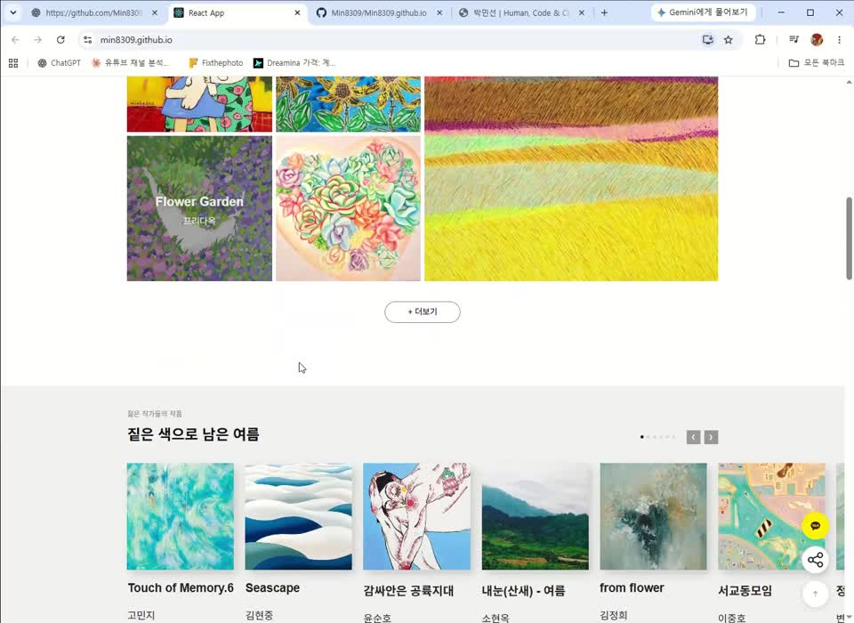

# 박민선 포트폴리오
https://parkminsunportfolio.vercel.app/
ㅡㅡ

**Human, Code & Clarity** — Creative Technologist & AI Frontend Developer 박민선의 포트폴리오입니다. 생성형 AI와 데이터를 몰입감 있는 웹 인터랙션으로 구현하며, 3D·Canvas 웹 경험과 AI·데이터 서비스 프론트엔드를 함께 소개합니다.

## 포트폴리오 컨셉

**삶의 깊이로 질문하고, 복잡한 기술을 사람의 언어로 설계합니다.**

42세의 삶에서 얻은 깊이 있는 문제의식을 바탕으로, 사용자의 고민과 선택을 이해하는 UI/UX·웹 디자인을 지향합니다. 복잡한 기술과 데이터를 이해하기 쉬운 화면과 흐름으로 연결하는 설계력을 강점으로 삼고 있습니다.

경험에 머무르지 않고, 변화하는 AI 도구와 웹 기술을 꾸준히 배우며 프로젝트에 적용합니다. 직접 질문하고 구현하고 오류를 확인하는 과정을 통해, 사람에게 명쾌하고 따뜻한 경험을 만드는 디자이너로 성장하고 있습니다.


## 프로젝트

| 번호 | 프로젝트 | 주요 내용 | 서비스 |
| --- | --- | --- | --- |
| 01 | Ateliera | WebGL 기반 3D 가상 화실과 디지털 페인팅 경험 | [데모](https://ateliera.vercel.app/) |
| 02 | MY AI LIFE | 선택과 공공 통계로 살펴보는 AI 인생 시뮬레이터 | [데모](https://min8309.github.io/my_ai_life/) |
| 03 | 서울, 어디서 놀고 어디서 벌까? | 서울 상권 데이터 분석과 창업자·소비자 맞춤 정보 | [서비스](https://dataseoul.streamlit.app/) |
| 04 | CSI LAB | 객체 탐지와 범죄 데이터를 결합한 수사 게임 경험 | [데모](https://csilab-kr.streamlit.app/) |
| 05 | EchoChamber : Rumor Lab | AI 에이전트 간 소문 전파와 왜곡 과정 시각화 | [데모](https://echochamber-y3r4.onrender.com/) |
| 06 | 시니어 뇌건강 헬퍼 | 두뇌 운동·대화·기억 기록·기기 사진 촬영을 제공하는 시니어 생활 도우미 | [서비스](https://senior-helper-seven.vercel.app/) |
| 07 | 촬라의 상상 — AI 영상 제작 | 일상의 사진을 AI 스토리와 영상으로 확장 | [YouTube](https://www.youtube.com/@MinsunPark-l2r) |
| 08 | 경성야록 (팀 프로젝트) | 신문 아카이브 기반 인터랙티브 콘텐츠 · DB 및 웹·모바일 게임 구현 담당 | [체험하기](https://ejdms499-wq.github.io/gyeongseong-yarok_v/opening.html) |
| 09 | 모닝블록 | 모듈형 오디오 루틴 · 모바일 UI·상태·콘텐츠 연결 | [프로젝트 소개](projects/morningblock.html) |
| 10 | 오픈갤러리 UI 구현 | React 기반 작품·상품 탐색 및 옵션·수량·금액 UI | [페이지별 화면](projects/open-gallery.html) · [사이트](https://min8309.github.io/) |
| 11 | 말줍 | 자막 표현 수집·녹음·3일 복습·학습 달력 웹앱 시제품 | [서비스](https://esl-101.onrender.com/) · [GitHub](https://github.com/Min8309/esl_101) |

### 모닝블록 — 모듈형 오디오 모닝 루틴 앱

바쁜 직장인이 루틴의 시간과 순서를 조립하고 음성으로 따라가는 앱입니다. 루틴 편집·오늘만 변경·실행 상태 분리, 오디오 콘텐츠 연결, 모닝콜 설정, 완료 기록을 구현했습니다. React Native/Expo, TypeScript, AsyncStorage를 사용합니다.

- 모듈별 1~30분 설정, 드래그 순서 변경, 일시정지·재개·완료 기록.
- 뉴스 RSS 제목·소개문, 외국어 기본 레슨 12개, 팟캐스트 이어 듣기와 기기 TTS.
- 모바일 모닝콜은 OS 예약 알림이며 웹은 설정만 저장합니다. 실기기 알림·백그라운드 재생, 실시간 RSS와 클라우드 음성 청취 검증은 남은 과제입니다.
- [첨부 자료 기반 프로젝트 소개](projects/morningblock.html). 앱 실행 데모가 아닌 소개 문서입니다.

### 포트폴리오 구성

- **카테고리 순서:** 데이터 기반 인사이트 → AI 서비스와 제품 기획 → 고객 경험과 커머스 → 브랜드와 콘텐츠.
- **대표 작업:** 경성야록 · Ateliera · EchoChamber · 말줍을 가로형 대표 카드로 크게 소개합니다. 한 문장 소개와 담당 역할을 먼저 보여주고, 상세 설명과 자료는 버튼으로 열어봅니다.
- **전체 분류:** 데이터 기반 인사이트(서울 핫플 분석·CSI LAB·EchoChamber), AI 서비스와 제품 기획(말줍·MY AI LIFE·모닝블록·Ateliera), 고객 경험과 커머스(시니어 헬퍼·오픈갤러리), 브랜드와 콘텐츠(경성야록·촬라의 상상) 순으로 총 11개를 배치합니다.
- **탐색:** 왼쪽 메뉴는 INDEX 아래 번호가 붙은 11개 프로젝트·프로필·연락처로 구성했습니다. 프로젝트 아카이브에는 대표작을 제외한 7개만 짧은 카드로 표시합니다. 상세 설명·발표자료·데모 링크는 상세 보기로 옮겼습니다.
- **가독성과 접근성:** 밝은 회청색 본문, 진한 블루 사이드바, 반응형 카드와 키보드 포커스·모션 최소화 지원.

### 경성야록 — 팀 프로젝트

1930년대 동아일보 신문 아카이브를 사건 본편, 현대어 풀이, 라디오, 참여 코너와 3D 게임으로 확장한 3인 팀 프로젝트입니다. 사건 4편·확장 코너 6개·게임을 하나의 탐색 경험으로 연결했습니다.

- **박민선 담당: 전체 DB 및 사건 자료 정리, 웹·모바일 게임 ‘식자실’ 구현.** 편집국 개발과 영상 제작도 담당했습니다.
- **굿즈 그래픽 디자인:** Adobe Illustrator로 로고·QR과 프로젝트 속 캐릭터·사물·신문 이미지를 한 장의 디자인 시트로 구성했습니다. [디자인 PDF 보기](presentations/gyeongseong-goods.pdf). 실제 상품 제작·판매 실적을 의미하지 않습니다.
- **게임:** Three.js(WebGL)·Vite 기반 1인칭 게임. 소지품 네 개를 모아 입장하고, 10분 안에 단서를 수집해 작업대 퍼즐을 풉니다. PC 키보드와 모바일 조이스틱 조작을 지원합니다.
- **협업:** 김소이 — 전체 디자인·UI·인터랙션 및 확장 코너 / 이경민 — 사건 서브페이지 및 독자 참여 콘텐츠. 연결 점검과 디자인 톤 통일은 공동 작업입니다.
- **자료 원칙:** 사건별 기록과 출처를 밝히고, AI 삽화·창작 글에 「재현」「재구성」을 표기합니다.
- **수익 모델:** 굿즈 그래픽 디자인과 별개로 실제 제작·판매 및 구독 확장은 후속 과제입니다. 신규 독자 유입·구독 전환은 측정된 성과가 아닙니다.
- [경성야록 체험하기](https://ejdms499-wq.github.io/gyeongseong-yarok_v/opening.html)

### 시니어 뇌건강 헬퍼

손자·손녀 캐릭터와 함께하는 모바일 중심 서비스로, 네 가지 기능을 2×2 버튼으로 구성했습니다.

- **두뇌 운동:** 숫자 순서, 경로 따라 그리기, 색상 맞추기, 소리·불빛 기억, 그림 짝 맞추기의 다섯 가지 단계별 활동.
- **물어보기:** 음성 인식과 글 입력 지원. 일반 대화는 준비된 응답 사용.
- **오늘의 기억:** 글과 음성 녹음 저장·재생. 기본 저장 위치는 현재 브라우저.
- **생활 도움:** Open-Meteo 날씨 조회와 기기 사진 촬영 화면.
- **기술 구성:** React 19, TypeScript, Vite 8, Tailwind CSS 4, 브라우저 음성·카메라 기능.

Supabase 클라우드 저장과 n8n·AI 사진 분석은 운영 연결 및 설정이 필요한 항목입니다. 실제 기기 권한, AI 안내 정확성 및 시니어 사용성 검증도 추가 확인 대상입니다.

### 촬라의 상상 — AI 영상 제작

직접 촬영한 일상의 사진에서 영감을 찾아, AI로 스토리를 만들고 움직이는 영상으로 확장하는 작업입니다. Gemini, Flow, CapCut, Adobe Premiere Pro 2025, Gems, n8n을 활용합니다.

- [오래된 집의 작은 정령들](https://www.youtube.com/watch?v=dq6IprFL5II): 오래된 대문 뒤의 정령들과 위기를 상상한 이야기.
- [탈주각](https://www.youtube.com/watch?v=cX2tMJmW-zk): 과거의 영광을 그리워하는 인형의 현실 도피 이야기.
- [퇴근 후 소주 한 병 마셨더니 곰이 되었습니다](https://www.youtube.com/watch?v=zIIUAnMNh0k): 버려진 인형에서 출발한 직장인 공감 콘텐츠.

## AI 및 제작 도구

페이지의 **AI & Toolkit** 섹션에서 도구를 역할별로 소개합니다.

| 분류 | 도구 | 활용 역할 |
| --- | --- | --- |
| 개발 환경 | Visual Studio Code, Google Antigravity | 코드 편집·실행 및 에이전트 기반 개발 흐름 |
| 생성형 AI·코딩 에이전트 | ChatGPT, OpenAI Codex, Claude | 기획 정리, 구현 지원, 코드·문서 검토 |
| 비전 AI·모델 플랫폼 | Ultralytics YOLO, Hugging Face | 객체 탐지 및 모델·데이터셋 탐색 |
| 백엔드·API | FastAPI | 프론트엔드와 데이터 처리 기능 연결 |
| UI/UX 디자인 | Figma | 화면·컴포넌트·인터랙션 설계 |

도구별 역할을 구분했으며, 모든 도구가 각 프로젝트에 동일하게 사용된 것은 아닙니다.

## 연락처

- YouTube: [운영 중인 영상 채널](https://www.youtube.com/@MinsunPark-l2r)

- Gmail: [minsunpark3421@gmail.com](mailto:minsunpark3421@gmail.com)
- 네이버 메일: [flushing3421@naver.com](mailto:flushing3421@naver.com)

## 로컬 실행

포트폴리오 자체는 `index.html`에 HTML·CSS·JavaScript를 담은 정적 페이지이며, 별도 패키지 설치나 빌드가 필요하지 않습니다. 위 기술 구성은 소개된 개별 프로젝트의 기술입니다.

저장소 루트에서 Python 3으로 실행합니다.

```bash
python3 -m http.server 8000
```

브라우저에서 `http://localhost:8000`을 열면 됩니다.

## 확인 내용

- 로컬 서버가 수정된 페이지를 제공하는지 확인.
- JavaScript 문법과 6개 프로젝트 상세 보기의 열기·닫기 동작 확인.
- 주요 텍스트·버튼 색상 대비 및 프로젝트 링크 반영 확인.

Chromium에서 320·390·768·1440px 화면의 가로 넘침, 6개 상세 보기의 열기·닫기와 포커스 이동, 모션 최소화 설정, JavaScript 오류 여부를 확인했습니다. 외부 폰트 요청을 차단한 기본 폰트 환경에서 검증했으며, 외부 서비스의 운영 상태는 별도 확인이 필요합니다.

추가 점검에서 인쇄 시 프로젝트가 숨겨지는 문제와 첫 화면 복귀 시 메뉴 선택 표시가 남는 문제를 수정했습니다. CSI LAB의 데이터 기간은 1990–2024년으로 통일했습니다. 외부 데모 요청은 환경의 네트워크 프록시에서 차단되어 실제 운영 상태를 검증하지 못했습니다.

## 프로젝트 발표자료

프로젝트 카드와 상세 보기에서 웹 열람용 PDF를 열 수 있으며, 상세 보기에서 원본 PPT도 내려받을 수 있습니다.

- 서울 핫플·상권 데이터 분석 — 37쪽: [PDF 보기](presentations/seoul-hotplace.pdf) · [PPT 원본](presentations/seoul-hotplace.pptx)
- CSI LAB 교육 프로젝트 — 42쪽: [PDF 보기](presentations/csi-lab.pdf) · [PPT 원본](presentations/csi-lab.pptx)

## 소개 및 가독성 구성

첫 화면은 직무 역량 소개와 대표 작업 바로가기에 집중합니다. 강점 카드 네 개는 프로필에 배치하며, 프로젝트에서 확인되는 사례를 연결합니다. 대표 작업의 상세 보기에는 설계 선택과 구현·검증 범위를 구분해 설명합니다. AI·개발 도구 소개는 프로젝트에서 사용한 역할 중심으로 축약했습니다. 기존 프로젝트와 발표자료는 유지합니다.

## 프로필 경력

- 방송 소품 대여실 8년: 소품 제작, 물품 출고·대여·물류관리, 고객 응대, 홈페이지 관리, 간단한 세무업무.
- 스튜디오: 촬영 보조, 사진 이미지 수정·편집, 고객 응대. 스튜디오 근무 기간은 별도로 명시하지 않습니다.
- 강점 카드에서 업무의 체계성과 꼼꼼함, 고객 소통, 촬영·이미지 편집 경험을 현재의 디자인·구현 작업과 연결합니다.

## 프로젝트 탐색

PC에서는 왼쪽 고정 사이드바의 프로젝트 10개 목록으로 각 카드에 바로 이동합니다. 현재 보고 있는 작업을 표시하며, 모바일·태블릿에서는 ‘프로젝트 메뉴’ 버튼으로 목록을 펼치고 이동 후 자동으로 닫습니다. Escape로 메뉴를 닫을 수 있습니다.

## AI 영상 제작 도구

- Newtake: 이야기와 장면 아이디어를 AI 영상 콘텐츠로 제작하는 데 활용.
- Flow: 사진·스토리를 바탕으로 AI 영상 생성, 장면의 움직임과 분위기 구체화.
- 사용 도구 섹션의 ‘AI 영상 제작 & 스토리 구현’ 카드에서 영상 프로젝트로 바로 연결합니다.


### 오픈갤러리 — 페이지별 화면 보기

[화면 보기](projects/open-gallery.html)에서 메인, 작품 목록, 작품 상세, 아트굿즈, 상품 상세, 로그인 화면을 탭으로 전환합니다. 화살표·Home·End 키를 지원하며 캡처를 누르면 큰 이미지를 엽니다. [발표자료 PDF](presentations/open-gallery-technology.pdf)를 새 탭에서 바로 볼 수 있습니다.

화면은 Min8309/Min8309.github.io의 배포 파일(6f60a76)을 2026-10-20 로컬 실행해 1440×1000px로 캡처한 WebP 이미지입니다. 공식 서비스 운영·실제 결제·인증 성과를 뜻하지 않으며 브랜드·작품 이미지의 권리는 각 권리자에게 있습니다. 원본 사이트의 모바일 가로 넘침은 확인된 개선 과제이며, 화면 보기 페이지는 반응형으로 구현했습니다.

#### 오픈갤러리 시연 영상

작품·상품 탐색 화면을 직접 조작하는 약 39초의 시연 영상입니다. 아래 썸네일 또는 링크를 클릭해 MP4 파일을 열 수 있습니다.

[](videos/open-gallery-demo.mp4)

[▶ 시연 영상 보기 (MP4 · 약 39초)](videos/open-gallery-demo.mp4)


### 말줍 — 나만의 표현 수집함

영상의 표현을 자막에서 골라 수집하고, 직접 녹음하며 3일 복습으로 이어가는 개인 학습 웹앱 시제품입니다. 색상별 형광펜·드래그 수집, 빈칸 퀴즈, 학습 달력·암기 체크리스트와 JSON 백업·복원을 제공합니다. JavaScript, IndexedDB, MediaRecorder 및 Node.js·Python을 사용합니다.

- 소개 기준: `Min8309/esl_101`의 `4c2656a` 커밋 README와 구현 코드. 카드 이미지는 데이터가 없는 초기 대시보드의 로컬 실행 화면입니다.
- Google Sheets 내보내기는 OAuth 설정이 필요하고, 유튜브 주소로 자막 가져오기는 Python 자막 도구와 서버가 필요합니다. AI 해설·발음 평가·계정 동기화는 구현 범위에 포함되지 않습니다.
- 포트폴리오에는 Render 서비스와 GitHub 저장소를 연결했습니다. 실제 마이크·Google 로그인·유튜브 자막 연동 성공을 확인한 것으로 표시하지 않습니다.


## 포트폴리오 UI 회귀 점검

Playwright와 Chromium이 설치된 환경에서 저장소를 정적 서버로 실행합니다.

```sh
python -m http.server 8000 --bind 127.0.0.1
```

다른 터미널에서 `node scripts/check-portfolio.cjs`를 실행합니다. 대표작·일반 카드 수, INDEX, 서비스 버튼, 상세창 재열기·스크롤 잠금 해제·포커스 복원, 반응형 배치, 모바일 메뉴, About Me 고정 색상을 확인합니다. `CHROMIUM_PATH`로 브라우저 실행 파일을, `PORTFOLIO_URL`로 점검할 사이트 주소를 지정할 수 있습니다. 이 점검은 외부 서비스의 실제 기능 동작을 보증하지 않습니다.


### 대표작 시각 자료와 설계 판단

첫 화면은 현장 경험과 데이터·AI 기반 서비스 설계를 소개합니다. 대표작마다 핵심 설계 판단 한 줄과 담당 역할을 분리해 표시합니다. 서울 핫플 분석은 기존 `presentations/seoul-hotplace.pdf` 안의 실제 대시보드·지도 캡처를 사용하며 과거 데이터 예시임을 표시했습니다. 말줍은 로컬 실행 대시보드와 표현 입력창, 시니어 헬퍼는 기존 홈 화면, 경성야록은 기존 실제 구동 시연 영상을 음소거·자동 반복 재생합니다. 보조 화면은 주요 화면보다 작게 배치하며 실제 사용 성과를 의미하지 않습니다.


### 서울어디가 이미지 슬라이드

서울 핫플 분석 대표작의 이미지 영역은 제공받은 `새 폴더 (2).zip`의 PNG 화면 7장을 원본 순서로 표시합니다. 사장님 모드 3장과 소비자 모드 4장이며, 좌우 버튼 또는 갤러리에 포커스를 둔 상태의 방향키로 순환합니다. 자동 재생은 하지 않고 현재 순서와 화면 설명을 표시합니다.

슬라이드는 제공된 PNG 원본의 비율을 유지해 이미지 영역에 표시합니다. 화면 비율은 유지하며, 좌우 버튼은 사이드바와 같은 블루(#355780)를 사용합니다.


### 말줍 PC·모바일 갤러리

사용자가 제공한 ZIP의 PC 대시보드·표현 수집함·녹음 보관함과 모바일 화면을 원본 이미지로 사용합니다. 작은 블루 꺾쇠 버튼으로 4장을 순환하며 비율을 유지합니다. 모바일 하단 메뉴와 형광펜·메모 수집 패널을 반응형 웹의 UX 사례로 소개합니다. 모바일 실제 기기의 녹음·권한 검증은 별도입니다.

말줍 상세창의 발표자료 버튼은 사용자가 제공한 `presentations/maljup-project.pdf`를 새 탭에서 엽니다.

대표작 영역은 데스크톱에서 최대 1680px 너비와 화면 높이에서 64px을 뺀 최소 높이를 사용합니다. 이미지 약 61%, 설명 약 39%의 폭으로 배치하고 짝수 카드는 좌우를 반전합니다. 모바일에서는 위아래 배치와 자연스러운 콘텐츠 높이를 유지합니다.

대표작 설명 영역에는 상세 자료를 바탕으로 사용자 관점·주요 구현·담당 범위를 3개 항목씩 요약해 표시합니다. 예측과 실제 값, 팀 결과와 본인 기여, 구현 완료와 추가 검증 범위를 구분합니다.


### 대표작 1~4번 정보와 확대 보기

대표 카드는 한 문장 소개·설계 판단·기여 3개와 상세/서비스 버튼 순서로 압축합니다. 나머지 7개 카드는 변경하지 않습니다. `크게 보기`는 원본 화면을 비율대로 표시하고 원본 크기/화면 맞춤, 새 탭 보기, 이미지 전환과 키보드 닫기를 제공합니다. 말줍 모바일 화면은 세로 원본을 유지하며 경성야록은 영상을 크게 재생합니다.

상세창 앞부분에는 문제·대응·확인 근거·검증 범위를 표시합니다. 서울어디가와 시니어 헬퍼는 제공된 발표자료, 경성야록은 시연/모바일 캡처를 근거로 합니다. 말줍의 중복 복습 방지는 확보 소스 `4c2656a`의 핵심 로직 테스트로 확인했으며, 배포 앱 전체/실기기 또는 사용자 성과 검증으로 표시하지 않습니다.


### 대표작의 트랙 A/B 구성

대표작은 TRACK A(경성야록·Ateliera)와 TRACK B(EchoChamber·말줍)를 2:2로 배치합니다. 트랙 A는 스토리텔링·3D·Canvas 인터랙션, 트랙 B는 자막·음성·클라이언트 DB와 데이터 시각화 프론트엔드를 강조합니다. 시니어 헬퍼는 아카이브의 고객 경험과 커머스로 이동하며 상세 자료와 휴대폰 클릭 링크를 유지합니다. 말줍 녹음 기술 배지는 확인된 MediaRecorder로 표기합니다.

Ateliera·말줍 대표 카드와 CSI LAB·EchoChamber 아카이브/상세 설명은 기술 기여 중심으로 소개합니다. 녹음은 MediaRecorder로 표기하고, 측정하지 않은 성능 향상·실시간성·사용자 효과를 결과로 단정하지 않습니다.


Track B는 EchoChamber·말줍으로 구성하며 서울 핫플 분석은 데이터 아카이브로 이동했습니다. EchoChamber 소스 `1f231a0`에서 JavaScript 프론트엔드와 FastAPI·OpenAI 연동 코드를 확인했습니다. React 근거는 없어 해당 배지는 사용하지 않습니다. 공개 버튼은 Render 배포 주소로 연결됩니다. 백엔드·LLM 기능은 서버와 키 설정이 필요하며 실제 동작 검증과 구분합니다. 대표 이미지는 기존 관계망 개념도로, 실제 서비스 화면으로 표시하지 않습니다.
